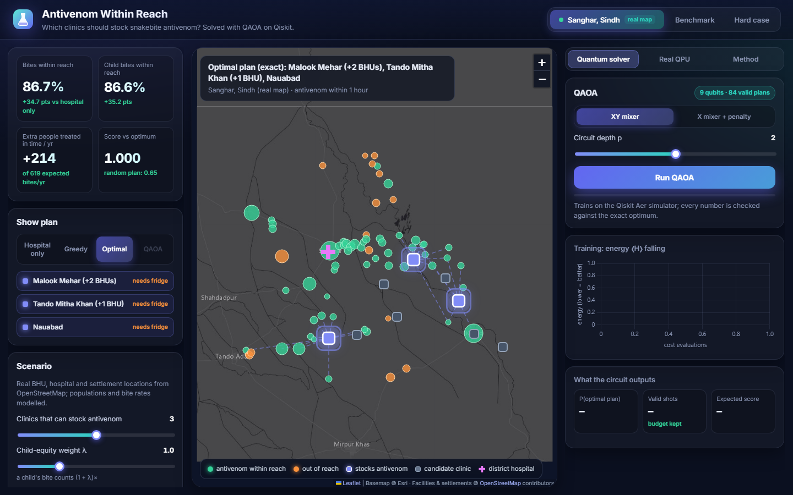
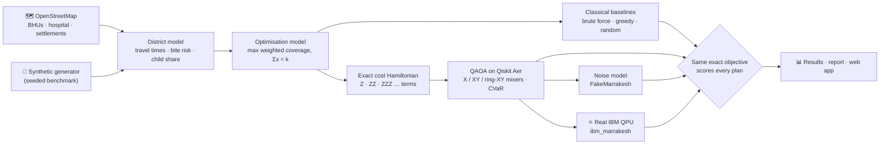
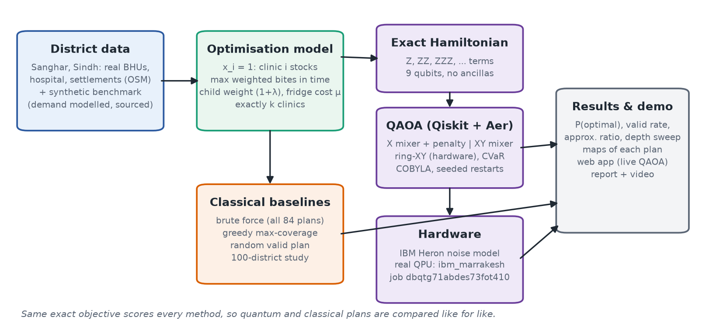
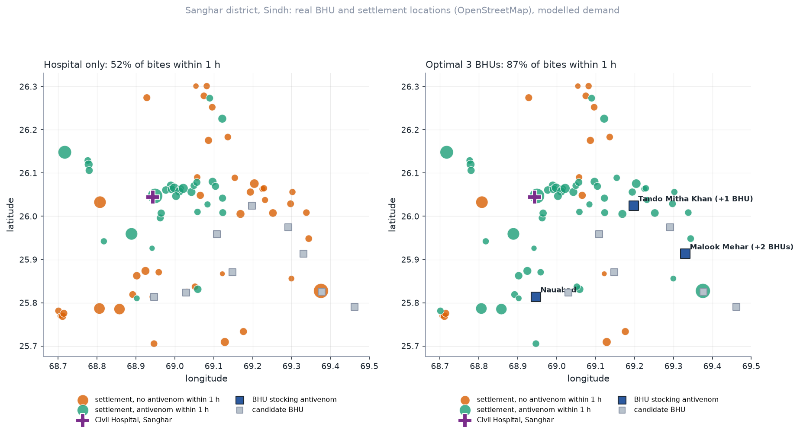
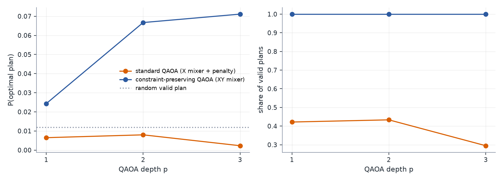
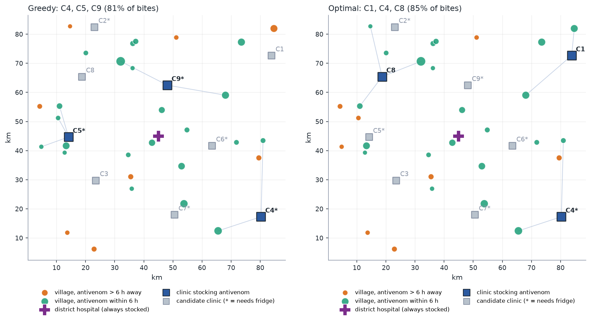
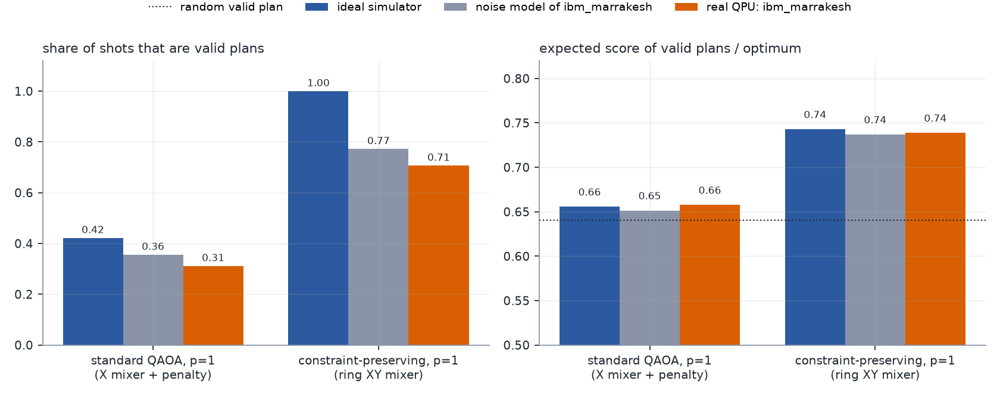
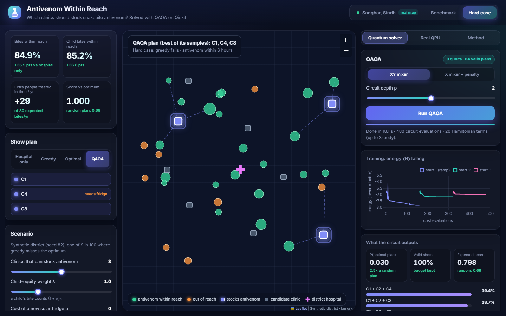
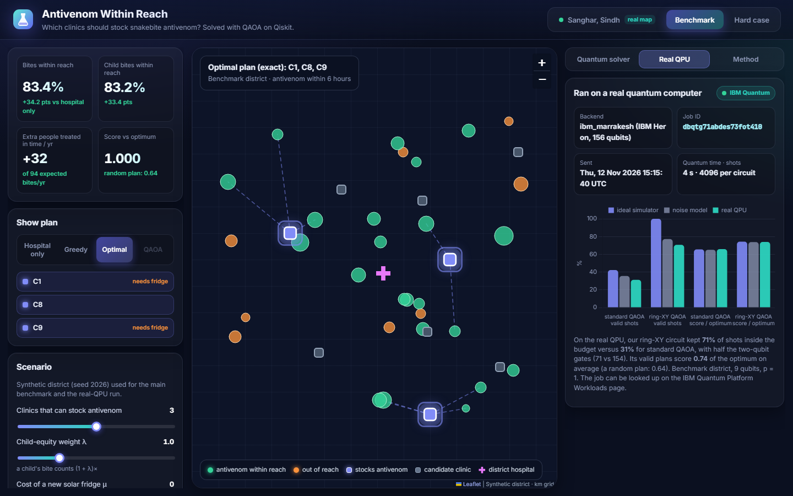
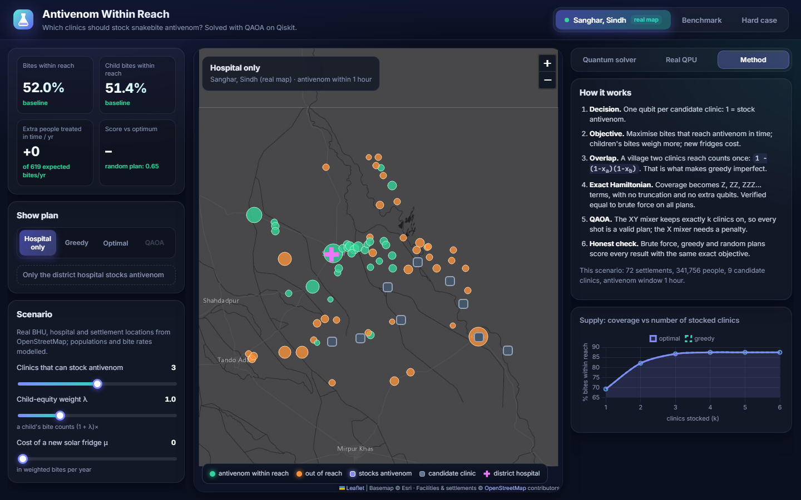

<div align="center">


# Antivenom Within Reach

**Quantum optimisation of snakebite antivenom placement in rural clinics**

*Which clinics should stock antivenom so that the most bites — children's weighted higher — reach treatment in time?*

[](https://www.python.org/)
[](https://www.ibm.com/quantum/qiskit)
[](https://github.com/Qiskit/qiskit-aer)
[](#3-real-ibm-quantum-computer)
[](#formulation)
[](check_model.py)
<br>
[](#)
[](#the-problem)
[](https://sdgs.un.org/goals/goal3)
[](https://www.openstreetmap.org/copyright)
[](LICENSE)

[**▶️ Demo video**](https://drive.google.com/file/d/17UOcJFbHMMxh0-nDvonKZo-XtzchPU0c/view?usp=sharing) · [**Report (.docx)**](docs/report.docx) · [**Run it**](#run-it) · [**Results**](#results) · [**Limitations**](#honest-limitations)



</div>

---

## Highlights

| | |
|---|---|
| 🗺️ **Real district** | Sanghar, Sindh, Pakistan — 72 mapped settlements, 15 government Basic Health Units and the Civil Hospital, from OpenStreetMap |
| 💉 **Impact** | Stocking 3 well-chosen BHU sites raises bites with antivenom **within 1 hour** from **52.0% → 86.7%**: about **214 more envenomings a year** treated in time (modelled demand) |
| ⚛️ **Exact quantum model** | 9 qubits; exact cost Hamiltonian with Z … 8-body terms — no QUBO truncation, no ancilla qubits — verified equal to brute force on all 512 bitstrings |
| 🎯 **Best algorithm** | Constraint-preserving QAOA (XY mixer): **100% valid shots**, optimal plan up to **10× more likely** than a random plan |
| 🖥️ **Real hardware** | IBM **ibm_marrakesh**, job [`dbqtg71abdes73fot410`](#3-real-ibm-quantum-computer): our ring-XY circuit kept **71%** of shots valid vs **31%** for standard QAOA, with half the two-qubit gates |
| ⚖️ **Honest baseline** | Greedy is optimal on 91 of 100 districts but misses by up to **10.6%** on the rest — we show one such case and QAOA finding the optimum |

## Contents

- [The problem](#the-problem) · [Formulation](#formulation) · [Architecture](#architecture)
- [Results](#results): [real district](#1-real-district-sanghar-sindh) · [benchmark](#2-benchmark-district) · [real QPU](#3-real-ibm-quantum-computer)
- [Demo app](#demo-app) · [Demo video](#demo-video) · [Run it](#run-it) · [Verify in 2 minutes](#verify-in-2-minutes)
- [Honest limitations](#honest-limitations) · [Hackathon checklist](#hackathon-checklist) · [Repository](#repository) · [Credits](#credits-and-references)

## The problem

Snakebite envenoming kills an estimated **81,000–138,000 people every year** and leaves many more
disabled (WHO). The victims are mostly rural farmers, herders and children; children suffer more
severe effects because of their smaller body mass. WHO aims to halve these deaths by 2030.

Antivenom only works if it reaches the patient in time, but it is expensive, scarce and — in liquid
form — needs a 2–8 °C cold chain. A **district health officer** (or an NGO supporting one) can
stock only a few clinics. Choose the wrong ones and whole villages are left without treatment in
time. This project answers: **which clinics should stock it?**

## Formulation

| Element | Definition |
|---|---|
| **Decision** | `x_i ∈ {0,1}` — candidate clinic *i* stocks antivenom (9 candidates → **9 qubits**) |
| **Coverage** | `covered_v = 1 − Π_{i ∈ S_v} (1 − x_i)`, where `S_v` = clinics reachable from village *v* in the time window |
| **Village weight** | `w_v` = expected envenomings per year × `(1 + λ · share of children_v)` |
| **Objective** | maximise `Σ_v w_v · covered_v − μ · Σ_i needs_fridge_i · x_i` |
| **Constraint** | `Σ_i x_i = k` (stock and staff budget); the district hospital is always stocked |

**Why it is quantum-shaped.** A village two clinics can reach must count once, not twice:
`x_a + x_b − x_a·x_b`. These overlap terms make the objective a polynomial in binary variables,
which is exactly why picking the individually best clinics (greedy) can fail. Substituting
`x_i = (1 − Z_i)/2`, each village contributes

$$w_v\Big(1 - 2^{-|S_v|}\sum_{T \subseteq S_v} \prod_{i\in T} Z_i\Big)$$

so a village reachable from 1, 2, 3, … clinics gives Z, ZZ, ZZZ, … terms. We implement this
**exact** Hamiltonian (each term is one CNOT-ladder rotation) instead of truncating to a QUBO, so
QAOA optimises exactly what the brute force scores.

**Algorithms** (all in [`avr/quantum.py`](avr/quantum.py), written for this project):

| Variant | Idea | Why |
|---|---|---|
| Standard QAOA | X mixer, budget as penalty `A(Σx − k)²` | the textbook baseline |
| **Constraint-preserving QAOA** | Dicke-state start + XX+YY mixer (Hadfield et al., 2019) | every shot is a valid plan, no penalty to tune |
| **Ring-XY QAOA** | one valid start plan + nearest-neighbour XY mixer | hardware-friendly: half the two-qubit gates |
| CVaR-QAOA | optimise the best α-fraction of outcomes (Barkoutsos et al., 2020) | pushes probability onto the very best plans |

Training uses COBYLA with a linear-ramp start and seeded restarts on the Qiskit Aer statevector
simulator; results are also sampled with 4096 shots.

## Architecture



<details>
<summary>Static architecture diagram (also in the report)</summary>



</details>

## Results

All numbers below are produced by the scripts in this repository with fixed seeds.

### 1. Real district: Sanghar, Sindh

[`run_sanghar.py`](run_sanghar.py) · locations are real (OpenStreetMap); populations, bite rates and
travel speeds are modelled ([`docs/data_sources.md`](docs/data_sources.md)). 15 government BHUs are
merged into 9 candidate sites when closer than 8 km. Window: 1 hour of travel.



| Plan | Sites stocked | Bites within 1 h | Child bites within 1 h |
|---|---|---|---|
| Civil Hospital only | — | 52.0% | 51.4% |
| **Exact optimum** (all 84 plans) | Malook Mehar (+2 BHUs), Tando Mitha Khan (+1 BHU), Nauabad | **86.7%** | **86.6%** |
| Greedy | same plan | 86.7% | 86.6% |
| Random valid plan | — | 0.65 × optimum | |

QAOA (XY mixer) raises the expected score of its plans from 0.65 (random) to **0.79** at p = 3, and
with CVaR (α = 0.1) the optimal plan becomes **8.4× more likely** than random. Villages here can
reach up to 8 sites, so the exact Hamiltonian has **263 terms up to 8-body**.

### 2. Benchmark district

[`run_experiments.py`](run_experiments.py) · synthetic, 30 villages, 40,655 people, 9 candidate clinics, k = 3, 6-hour window.

| Variant | Depth p | Valid outputs | P(optimal) | vs random | Expected score / optimum |
|---|---|---|---|---|---|
| X mixer + penalty | 1 / 2 / 3 | 42% / 43% / 29% | 0.006 / 0.008 / 0.002 | below random | 0.66 / 0.67 / 0.69 |
| **XY mixer** | 1 / 2 / 3 | **100%** | 0.024 / 0.067 / **0.071** | **2.0× / 5.6× / 6.0×** | 0.71 / 0.72 / 0.73 |
| **XY + CVaR α = 0.1** | 2 | **100%** | **0.120** | **10×** | 0.64 |

<p align="center"></p>

- **Penalties are fragile.** Penalty 0.1× the largest weight → 2% valid; 3× → 62% valid but the
  objective is drowned (P(optimal) 0.008). The XY mixer removes the penalty entirely.
- **Greedy is not always enough.** On 100 random districts greedy misses the optimum in 9, by up to
  10.6%. On the hard case (seed 82) greedy covers 80.8% of bites and the optimum 84.9%; QAOA
  (XY, p = 3) gives the optimal plan probability 0.062 (5.2× random) and samples it. On the
  benchmark, greedy also misses at k = 5 (91.9% vs 93.4%).
- **Trade-offs.** The child weight λ changes the optimal plan in 6 of 100 districts (children are
  spread evenly, so the efficient plan is already near-best for them); a fridge cost μ ≥ 2 swaps
  one clinic so only one new fridge is needed instead of two.

<p align="center"></p>

### 3. Real IBM quantum computer

[`run_hardware.py`](run_hardware.py) · IBM **ibm_marrakesh** (IBM Heron, 156 qubits) · job
**`dbqtg71abdes73fot410`** · sent 2026-11-12 15:15:40 UTC · 4096 shots per circuit · 4 s of QPU
time · raw counts in [`results/hardware_counts.json`](results/hardware_counts.json).

<p align="center"></p>

| Circuit (benchmark, 9 qubits, p = 1) | Two-qubit gates | Valid shots: ideal → noise model → **real QPU** | Score / optimum on real QPU |
|---|---|---|---|
| Standard QAOA (X + penalty) | 154 | 42% → 36% → **31%** | 0.66 |
| **Ring-XY QAOA (ours)** | **71** | 100% → 77% → **71%** | **0.74** (random: 0.64) |

The real device closely matches the noise-model prediction, and the constraint-preserving circuit
keeps more than twice as many shots inside the budget while producing better plans than random.

## Demo app

A custom web app (Python standard-library API + Leaflet + Chart.js) on top of the same solvers:
switch districts, move the budget / child-weight / fridge-cost sliders, compare hospital-only,
greedy, optimal and QAOA plans on the map, and **watch QAOA train live** on Qiskit Aer.

| Real district, optimal plan | QAOA on the hard case |
|---|---|
|  |  |
| **Real QPU panel** | **Method and supply curve** |
|  |  |

## Demo video

▶️ **[Watch the 3-minute pitch and demo on Google Drive](https://drive.google.com/file/d/17UOcJFbHMMxh0-nDvonKZo-XtzchPU0c/view?usp=sharing)** (2:45 · 1080p)

## Run it

```bash
git clone https://github.com/raheemxghumman/antivenom-within-reach.git
cd antivenom-within-reach
python -m venv .venv
# Windows: .venv\Scripts\activate      macOS / Linux: source .venv/bin/activate
pip install -r requirements.txt

python app.py                    # demo app → http://127.0.0.1:8765 (opens your browser)
python app.py --window           # same, in a desktop window (optional: pip install pywebview)
```

| Command | What it does | Time |
|---|---|---|
| `python check_model.py` | self-checks: quantum model == classical model | seconds |
| `python run_experiments.py` | benchmark results and figures | ~6 min |
| `python run_sanghar.py` | real-district case study | ~6 min |
| `python run_noisy.py` | IBM noise-model study | ~3 min |
| `python run_hardware.py --dry-run` | full hardware pipeline on a noise model, no account needed | ~2 min |
| `python run_hardware.py` | real IBM QPU run (needs a saved IBM Quantum account) | queue + seconds |
| `python docs/make_report.py` | rebuild the report from `results/` | seconds |

Tested with Python 3.13 on Windows 11. The app needs internet only for map tiles and fonts; all
computation is local. For hardware, save an account once with
`QiskitRuntimeService.save_account(channel="ibm_quantum_platform", token=..., instance=...)` —
never commit it.

## Verify in 2 minutes

```text
$ python check_model.py
1. Hamiltonian vs brute-force objective, max error: 4.0e-13
2. SparsePauliOp diagonal vs energies, max error:  1.1e-13
3. QuadraticProgram (pairwise only) vs exact: 4 villages reach 3+ clinics, max gap 6.02 -> exact ZZZ terms are needed
4. Aer QAOA probabilities vs numpy reference, max error: 3.2e-17
5. XY-mixer probability on valid plans: 1.000000000000
All checks passed.
```

## Honest limitations

- **Modelled demand.** Facility and settlement locations in Sanghar are real; populations (except
  Sanghar city and Khipro), bite incidence, child share and travel speeds are modelled from
  published ranges. No public dataset gives snakebites per village; real data drops in without
  code changes.
- **No speed-up claim.** At 9 qubits brute force takes milliseconds. The contribution is an exact
  quantum formulation, measured against exact answers and run end-to-end on real hardware.
- **Shallow QAOA.** At p ≤ 3 QAOA concentrates probability on good plans (up to 10× random) but
  the optimum is not the single most likely plan; on the real district plain QAOA improves average
  plan quality but needs CVaR to favour the optimum.
- **Noise.** The best simulated circuit (all-pairs XY from a Dicke state) is too deep for today's
  hardware (depth 3,052); the ring variant runs, but noise erodes its guarantee from 100% to 71%.
- **Model scope.** Binary coverage within a time window; no rainy-season roads, vial counts, expiry
  or upstream supply. BHUs closer than 8 km are merged into one site to fit 9 qubits.

## Hackathon checklist

| Rubric criterion | Where it is addressed |
|---|---|
| **A. Problem validity** — real problem, clear formulation, small scope, measurable | [The problem](#the-problem) · [Formulation](#formulation) · real Sanghar data · coverage % and bites/yr |
| **B. Meaningful quantum use** — mapping, algorithm justification, limits | exact Hamiltonian · XY vs penalty comparison · CVaR · [limitations](#honest-limitations) |
| **C. Implementation & validation** — working code, baselines, reproducibility | brute force · greedy · random · 100-district study · `check_model.py` · fixed seeds · pinned versions |
| **D. Innovation** — originality, technical extension | exact higher-order coverage Hamiltonian · ring-XY hardware circuit · real-QPU run · real district |
| **E. Presentation** — clarity, demo | [demo app](#demo-app) · [report](docs/report.docx) · [video script](docs/video_script.md) |

## Repository

```text
antivenom-within-reach/
├── app.py                 demo app server (Python standard library)
├── ui/                    web front end (HTML · CSS · JS, Leaflet, Chart.js)
├── avr/
│   ├── instance.py        synthetic district generator (seeded)
│   ├── sanghar.py         real-geography district from OpenStreetMap data
│   ├── model.py           exact objective, plan reports, Qiskit QuadraticProgram
│   ├── classical.py       brute force, greedy, random baselines
│   ├── quantum.py         exact Hamiltonian, QAOA (X / XY / ring-XY), CVaR, sampling
│   └── plots.py           figures
├── check_model.py         self-checks
├── run_experiments.py     benchmark study
├── run_sanghar.py         real-district study
├── run_noisy.py           noise-model study
├── run_hardware.py        real IBM QPU run
├── data/sanghar_osm.json  OpenStreetMap extract (ODbL)
├── results/               JSON results, figures, real-QPU counts
└── docs/                  report (.docx), data sources, architecture, screenshots, video script
```

## Credits and references

All code in this repository was written for this hackathon. Map data © OpenStreetMap contributors
(ODbL); basemap © Esri.

1. WHO, *Snakebite envenoming* fact sheet (2023).
2. Chippaux J-P., Estimate of the burden of snakebites in sub-Saharan Africa, *Toxicon* 57 (2011).
3. Suraweera W. et al., Trends in snakebite deaths in India from 2000 to 2019, *eLife* 9 (2020).
4. Farhi E., Goldstone J., Gutmann S., A Quantum Approximate Optimization Algorithm, arXiv:1411.4028 (2014).
5. Hadfield S. et al., From the QAOA to a Quantum Alternating Operator Ansatz, *Algorithms* 12(2), 34 (2019).
6. Barkoutsos P. et al., Improving Variational Quantum Optimization using CVaR, *Quantum* 4, 256 (2020).
7. Church R., ReVelle C., The maximal covering location problem, *Papers of the Regional Science Association* 32 (1974).
8. Qiskit blog, *Where should I locate my store?* — QAOA for a related covering problem.

<div align="center"><sub>Built for Qiskit Fall Fest 2026 · FAST NUCES Islamabad · MIT licensed</sub></div>
